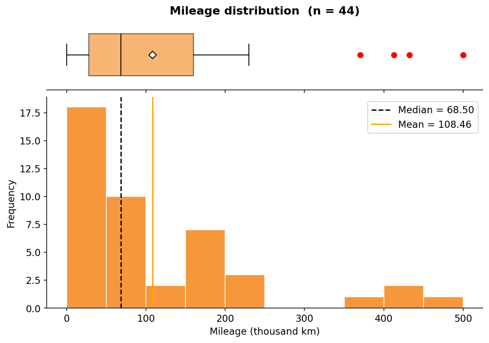
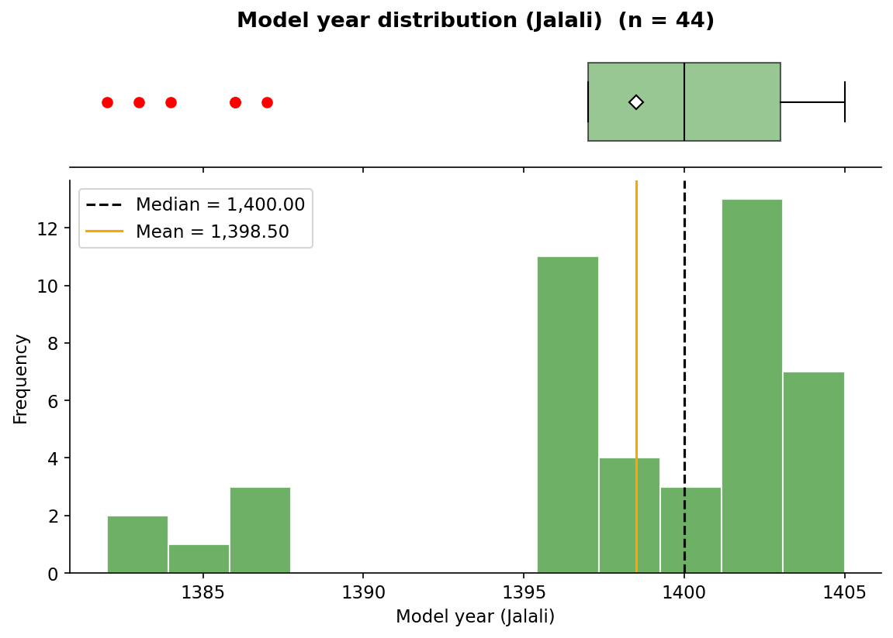
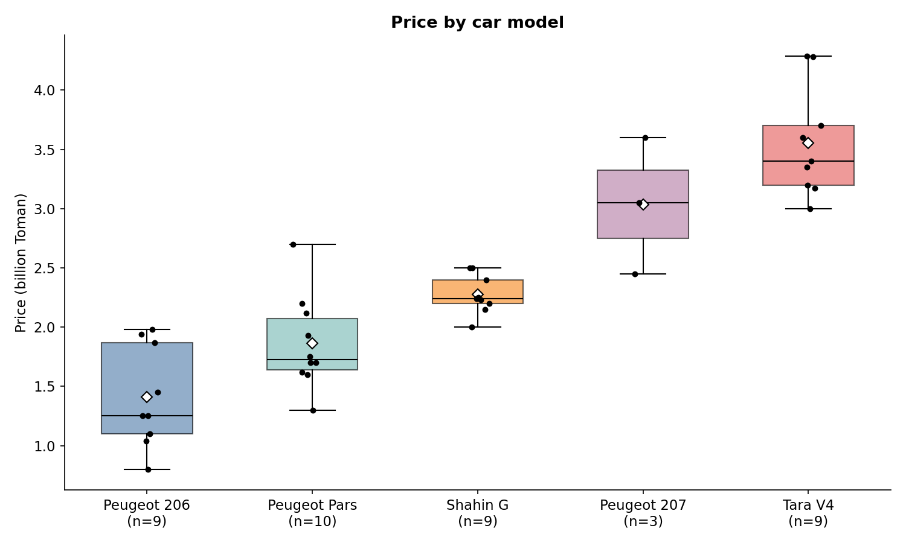
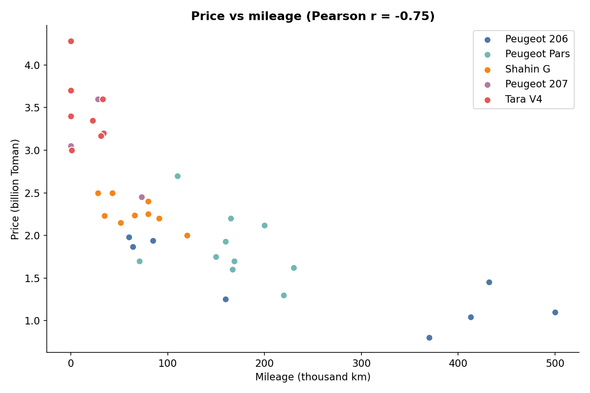

# تحلیل ویژوالایزیشن داده‌های آگهی خودرو

داده‌ها شامل **۴۴ آگهی خودرو** از سایت باما است. این آگهی‌ها مربوط به ۵ مدل (پژو ۲۰۶، پژو پارس، پژو ۲۰۷، شاهین G و تارا V4) هستند. در ادامه برای هر نمودار، نتیجه‌ی ویژوالایزیشن و تحلیل آن آمده است.

## ۱. تعداد نمونه‌ها

- در مجموع ۴۴ آگهی جمع‌آوری شده است.
- چهار مدل (۲۰۶، پارس، شاهین G و تارا V4) هرکدام ۱۰ نمونه دارند و پژو ۲۰۷ فقط ۴ نمونه.
- ۴۱ آگهی قیمت ثبت‌شده دارند. سه آگهی «قیمت توافقی» هستند و قیمتی ندارند.
- ۴۰ آگهی قیمت معتبر دارند. یک آگهی صفر کیلومتر مبلغ ۶۰ میلیون تومان را ثبت کرده که در واقع قسط ماهانه است و حذف شد.
- ۳۵ آگهی مربوط به خودروی کارکرده با قیمت معتبر است.

**تحلیل:** نمونه‌ها بین چهار مدل متوازن‌اند، اما مدل ۲۰۷ فقط ۴ نمونه (۳ نمونه با قیمت معتبر) دارد. بنابراین نتیجه‌گیری درباره‌ی این مدل قابل اتکا نیست. حجم کل داده هم کوچک است و یافته‌ها جنبه‌ی توصیفی دارند و قابل تعمیم به کل بازار نیستند.

## ۲. توزیع قیمت (هیستوگرام + Box Plot)

| آماره | مقدار (میلیارد تومان) |
|---|---|
| تعداد | ۴۰ |
| میانگین | ۲.۳۲ |
| میانه | ۲.۲۰ |
| انحراف معیار | ۰.۸۸ |
| کمینه / بیشینه | ۰.۸۰ / ۴.۲۹ |
| چارک اول / سوم | ۱.۷۰ / ۳.۰۱ |

**تحلیل:**
- میانگین اندکی بزرگ‌تر از میانه است (چولگی حدود ۰.۵)، یعنی توزیع کمی به راست متمایل است.
- طبق قانون IQR داده‌ی پرتی وجود ندارد (حد بالا حدود ۴.۹۸ میلیارد).
- هیستوگرام یک‌قله‌ی منظم نیست، چون مدل‌هایی با سطح قیمتی متفاوت در یک نمودار ترکیب شده‌اند (مثلاً ۲۰۶ حدود ۱.۲ و تارا حدود ۳.۴ میلیارد). این نشان می‌دهد توزیع کلی ترکیبی از چند گروه است.

## ۳. توزیع کارکرد (هیستوگرام + Box Plot)

**تحلیل:**
- میانه‌ی کارکرد ۶۸٬۵۰۰ کیلومتر و میانگین ۱۰۸٬۴۵۶ کیلومتر است.
- چولگی زیاد به راست (حدود ۱.۷) و انحراف معیار بزرگ (حدود ۱۲۲ هزار) دیده می‌شود.
- در Box Plot چهار داده‌ی پرت وجود دارد: ۳۷۰، ۴۱۳، ۴۳۲ و ۵۰۰ هزار کیلومتر.
- شش آگهی صفر کیلومتر هستند و ستون کنار صفر هیستوگرام را می‌سازند.

بیشتر خودروها کارکرد کم تا متوسط دارند و چند خودروی بسیار کارکرده میانگین را بالا می‌کشند. به همین دلیل برای این متغیر **میانه شاخص مناسب‌تری از میانگین است**. داده‌های پرت خطای ثبت نیستند و خودروهای واقعاً قدیمی هستند.

## ۴. توزیع سال ساخت (هیستوگرام + Box Plot)

**تحلیل:**
- میانه‌ی سال ساخت ۱۴۰۰ و میانگین ۱۳۹۸.۵ است و بازه از ۱۳۸۲ تا ۱۴۰۵ را شامل می‌شود.
- چولگی منفی (حدود ۱.۴-) نشان می‌دهد دم توزیع به سمت سال‌های قدیمی‌تر است.
- شش داده‌ی پرت (سال‌های ۱۳۸۲ تا ۱۳۸۷) وجود دارد که خودروهای بسیار قدیمی‌تر از بقیه هستند.

بیشتر آگهی‌ها مربوط به خودروهای ۱۳۹۷ به بعد هستند. خودروهای قدیمی، همان‌هایی هستند که در نمودار کارکرد پرت بودند و در نمودار قیمت در بخش پایین قرار دارند.

## ۵. قیمت به تفکیک مدل (Box Plot)

| مدل | تعداد (با قیمت معتبر) | میانه (میلیارد تومان) | توضیح |
|---|---|---|---|
| پژو ۲۰۶ | ۹ | ۱.۲۵ | ارزان‌ترین، بازه‌ی ۰.۸ تا ۱.۹۸ |
| پژو پارس | ۱۰ | ۱.۷۳ | بازه‌ی ۱.۳ تا ۲.۷ |
| شاهین G | ۹ | ۲.۲۴ | کم‌پراکنده‌ترین (انحراف معیار حدود ۰.۱۶) |
| پژو ۲۰۷ | ۳ | ۳.۰۵ | نمونه‌ی کم، تفسیر با احتیاط |
| تارا V4 | ۹ | ۳.۴۰ | گران‌ترین، تا ۴.۲۹ |

**تحلیل:** مدل خودرو قوی‌ترین عامل تفکیک قیمت در این داده است و جعبه‌ی ۲۰۶ و تارا تقریباً هم‌پوشانی ندارند. پراکندگی کم شاهین G احتمالاً به این دلیل است که سال ساخت و کارکرد آگهی‌های آن به هم نزدیک است.

## ۶. رابطه‌ی قیمت و کارکرد (Scatter Plot)

- همبستگی پیرسون قیمت و کارکرد حدود **۰.۷۵-** است.
- همبستگی قیمت و سال ساخت حدود **۰.۷۶+** است.
- کارکرد و سال ساخت نیز همبستگی حدود ۰.۷۹- با هم دارند.

**تحلیل:** هرچه خودرو قدیمی‌تر و کارکرده‌تر باشد، قیمت آن پایین‌تر است. بخشی از این رابطه به اثر مدل برمی‌گردد، زیرا خودروهای قدیمی بیشتر ۲۰۶ و پارس هستند که ذاتاً ارزان‌ترند. همبستگی به معنای رابطه‌ی علّی نیست.

## نتیجه‌گیری

- قیمت خودروها در این نمونه عمدتاً با **مدل، سال ساخت و کارکرد** مرتبط است.
- توزیع قیمت ترکیبی از چند گروه است و توزیع کارکرد و سال ساخت چولگی و داده‌ی پرت دارند. بنابراین برای توصیف آن‌ها میانه مناسب‌تر از میانگین است.
- حجم نمونه کوچک است (۴۴ آگهی، با ۳ نمونه برای ۲۰۷)، پس نتایج صرفاً توصیفی هستند.

## محدودیت‌ها

- داده‌ها در یک زمان مشخص (۲۴ اکتبر ۲۰۲۶) از آگهی‌های باما جمع‌آوری شده و قیمت‌ها قیمت درخواستی فروشنده‌اند، نه قیمت نهایی معامله.
- چند ستون (مثل حجم موتور، تعداد دنده و رنگ) کاملاً خالی بودند و در تحلیل استفاده نشدند.

