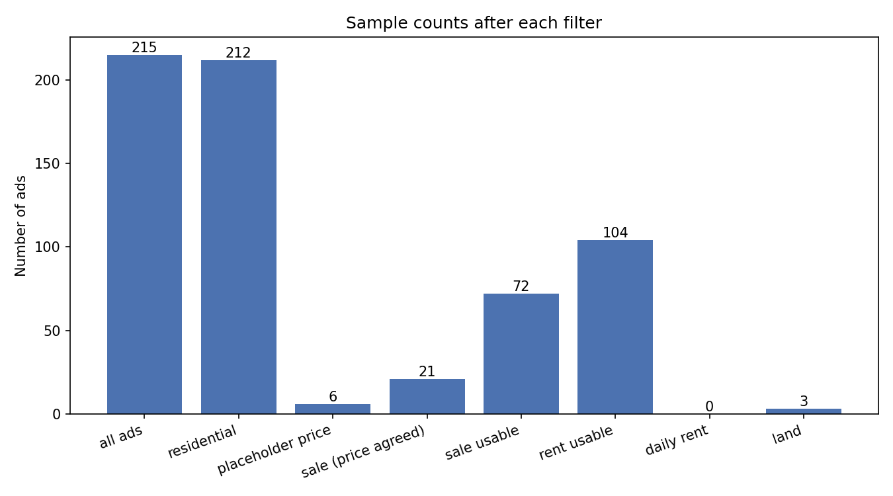

# داده‌کاوی آگهی‌ها — خودرو و ملک

مجموعه‌ی دو تمرین درس **داده‌کاوی**: جمع‌آوری، پاک‌سازی و ویژوالایز آگهی‌های واقعی از دو سایت ایرانی، همراه با تحلیل فارسی هر نمودار و جدول‌های آماری.


*Data mining course projects: visual analytics of Iranian car ads (bama.ir) and real-estate ads (sheypoor).*

## پروژه‌ها در یک نگاه

| پروژه | موضوع | داده | خروجی |
|---|---|---|---|
| [Project1](Project1/) | ویژوالایز آگهی خودرو — باما | ۴۴ آگهی خودرو | ۶ نمودار |
| [Project2](Project2/) | قیمت فروش و اجاره‌ی ملک — شیپور | ۲۱۵ آگهی ملک | ۱۶ نمودار + ۴ جدول + خلاصه‌ی آماری |

هر دو پروژه مستقل‌اند: پوشه‌ی خودشان، `requirements.txt` خودشان و `ANALYSIS.md` خودشان. داده‌ی خام از قبل در مخزن هست، پس برای دیدن نمودارها لازم نیست اسکرپر اجرا شود.

## ۱. خودرو — [Project1](Project1/)

ویژوالایز آگهی‌های خودروی سایت باما؛ تمرکز روی توزیع قیمت، کارکرد و سال ساخت و مقایسه‌ی مدل‌ها.

**نمودارها:** تعداد نمونه‌ها · توزیع قیمت (هیستوگرام + Box Plot) · کارکرد · سال ساخت · قیمت به تفکیک مدل · قیمت در برابر کارکرد (Scatter)


- کد و راهنمای پروژه: [Project1/README.md](Project1/README.md)
- تحلیل فارسی هر نمودار: [Project1/ANALYSIS.md](Project1/ANALYSIS.md)
- داده: [`Project1/data/cars_test.csv`](Project1/data/cars_test.csv)

## ۲. ملک — [Project2](Project2/)

جمع‌آوری آگهی‌های ملک از شیپور، ویژوالایز قیمت فروش و اجاره، کشف آگهی‌های غیرعادی و مقایسه‌ی محله‌ها.

**نمودارها:** تعداد نمونه‌ها · قیمت/متراژ/قیمت هر متر فروش · قیمت در برابر متراژ · قیمت هر متر به تفکیک شهر و محله · تعداد اتاق · سال ساخت · ماتریس همبستگی · آگهی‌های غیرعادی · رهن · اجاره‌ی ماهانه · ارتباط‌های اجاره



- کد و راهنمای پروژه: [Project2/README.md](Project2/README.md)
- تحلیل فارسی هر نمودار: [Project2/ANALYSIS.md](Project2/ANALYSIS.md)
- داده: [`Project2/data/sheypoor_all.csv`](Project2/data/sheypoor_all.csv)
- خلاصه‌ی عددی: [`Project2/output/summary.txt`](Project2/output/summary.txt)

## راهنمای اجرا

پیش‌نیاز: پایتون ۳.

```bash
# هر پروژه جداگانه نصب و اجرا می‌شود
cd Project1
pip install -r requirements.txt
python cars_visualization.py
```

```bash
cd Project2
pip install -r requirements.txt
python realestate_visualization.py
```

نمودارها در پوشه‌ی `output/` همان پروژه ساخته می‌شوند؛ همان تصاویر بدون نصب هیچ کتابخانه‌ای، مستقیم در همین مخزن هم قابل دیدن‌اند.

## ساختار مخزن

```
data-mining/
├── Project1/                     # آگهی خودرو (باما)
│   ├── data/cars_test.csv        # ۴۴ ردیف
│   ├── cars_visualization.py     # پاک‌سازی داده و رسم نمودارها
│   ├── output/                   # ۶ نمودار PNG
│   ├── ANALYSIS.md               # تحلیل فارسی
│   └── requirements.txt
└── Project2/                     # آگهی ملک (شیپور)
    ├── data/sheypoor_all.csv     # ۲۱۵ ردیف
    ├── realestate_visualization.py
    ├── output/                   # ۱۶ نمودار + جدول‌ها + summary.txt
    ├── ANALYSIS.md               # تحلیل فارسی
    └── requirements.txt
```

## یافته‌های کلیدی

- **قیمت فروش ملک چوله است:** میانگین ۱۱٬۹۶ میلیارد تومان در برابر میانه‌ی ۶٬۶۰ (چولگی ۴٬۲۷)؛ یعنی چند آگهی گران، میانگین را بالا کشیده‌اند و میانه تصویر واقعی‌تری می‌دهد.
- **متراژ توضیح‌دهنده‌ی ضعیفی برای قیمت است:** همبستگی متراژ و قیمت فروش `r = 0.45` و متراژ با قیمت هر متر فقط `r = 0.14` — موقعیت ملک مهم‌تر از اندازه‌ی آن است.
- **شکاف قیمتی شهرها:** میانه‌ی قیمت هر متر در تهران ۱۷۷٬۹ میلیون تومان در برابر اندیشه ۷۱٬۲ میلیون.
- **بازار اجاره دو نیمه دارد:** از ۱۰۴ آگهی قابل استفاده، ۵۵ مورد رهن + اجاره و ۴۹ مورد رهن کامل بوده است.
- **آگهی‌های غیرعادی** با قاعده‌ی z-score و سه‌برابر میانه (در محدوده‌ی هر شهر) جدا شده‌اند و در `sale_anomalies.csv` و `rent_anomalies.csv` ذخیره شده‌اند.

## محدودیت‌ها

- حجم نمونه کوچک است (۴۴ و ۲۱۵ آگهی)؛ این تحلیل‌ها **توصیفی**اند، نه مدل پیش‌بینی.
- آگهی‌های تکراری، «قیمت توافقی» و قیمت‌های جایگزین‌شده (مثل ۱ تومان) پیش از تحلیل حذف یا کنار گذاشته شده‌اند.
- آگهی‌های بدون قیمت یا خارج از بازه‌ی متراژ منطقی (۱۵ تا ۲۰۰۰ متر) در محاسبات نیامده‌اند.

## ادامه‌ی کار

قدم بعدی طبیعی، ساختن مدل تخمین قیمت (رگرسیون روی متراژ، اتاق، شهر و محله) با همین داده‌هاست؛ بستری که `summary.txt` و جدول محله‌ها برایش آماده شده است.
