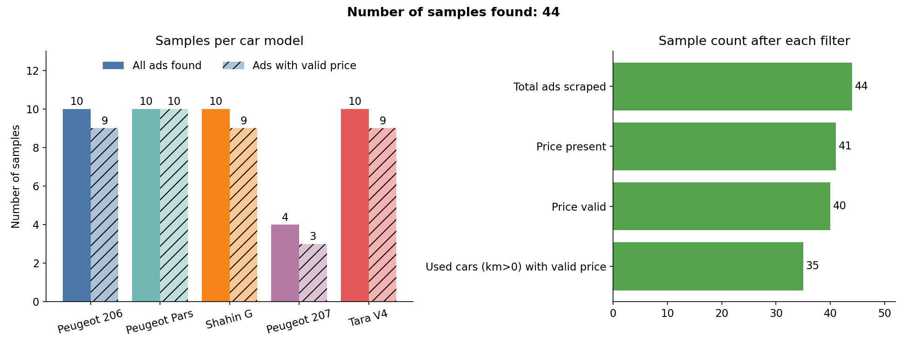
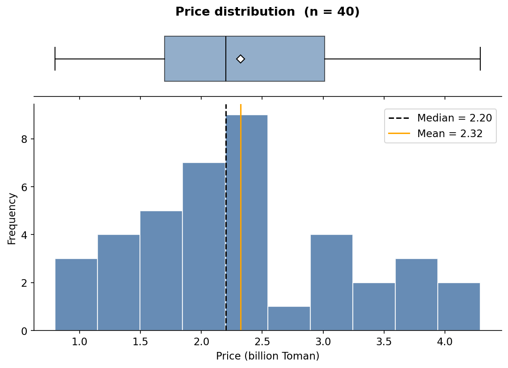

# Cars Data Visualization

Data mining course project: visualizing used-car ads (44 samples) scraped from bama.ir.

## Charts
- Number of samples
- Price / mileage / model year (histogram + box plot)
- Price by model (box plot)
- Price vs mileage (scatter plot)

## Run
```bash
cd Project1
pip install -r requirements.txt
python cars_visualization.py
```

Charts are saved in the `Project1/output/` folder.

## Preview

